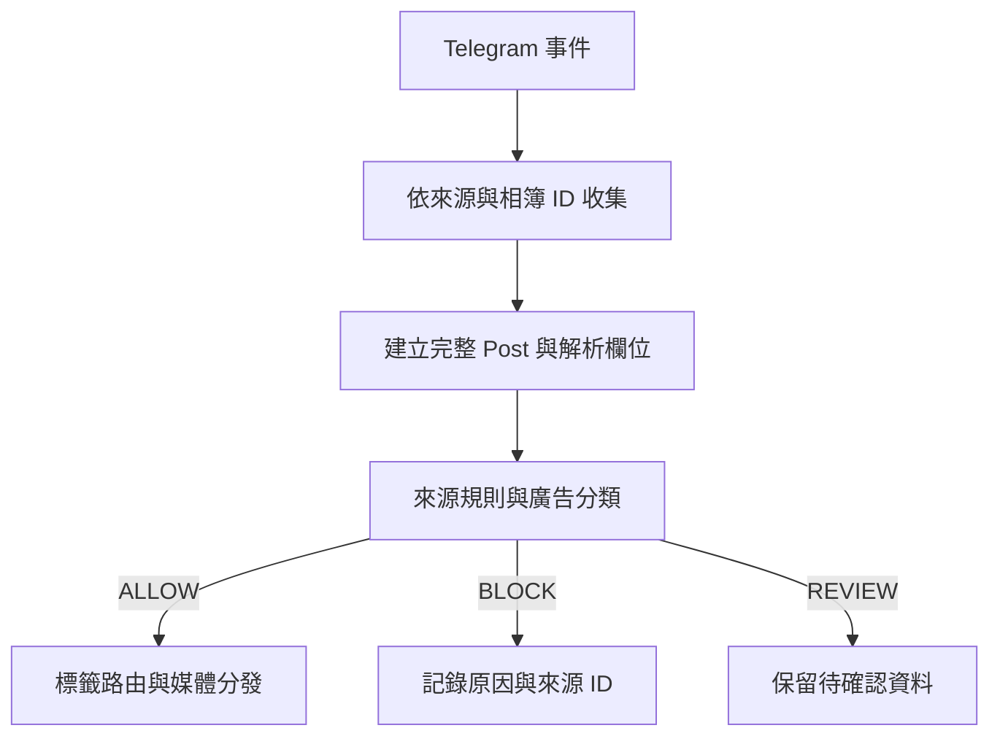

# ImageBOT 架構與廣告篩選改進筆記

更新日期：2026-11-02  
狀態：討論整理與待實作提案；本次僅新增文件，尚未修改執行程式。

## 1. 目的與交接方式

這份文件整理本次 Telegram PFPT 頻道格式觀察、與使用者的討論、現有程式核對結果，以及後續可實作的架構方向。回家 pull 後，可直接以此作為 coding agent 的上下文。

核心目標：

- 阻擋互推、商業推廣及其他非作品內容。
- 降低正常作品、無 caption 媒體及相簿成員被誤攔的機率。
- 避免把上一則作品的 caption／標籤套用到下一則獨立媒體。
- 保留可追查的判斷理由，讓規則可以用實際樣本調整。
- 先改善現有 Python／Telethon 非同步流程，媒體壓縮、R2 與 Discord 分發繼續沿用。

本文件中的建議尚未經使用者逐項定案，分數與門檻也尚未校準。現有行為與提案不能混為一談。

## 2. 資料來源與證據邊界

### 2.1 程式核對基準

Repository：NekoMaTA864/tg-to-discord-bot，預設分支 main。

本次直接讀取：

- README.md，blob SHA：0416b08d5dfc0b4aff96e561941379f5c41c5033
- main.py，blob SHA：f75da9caa0215b69b562c5f478fab639db30e5d3
- logic.py，blob SHA：9858ddd60ab088f08e6f033dbde1170eea3d0e62

根目錄 architecture.md 與 AGENTS.md 讀取結果為不存在。README 提及 config.example.json，但本次讀取該路徑也是 404；後續實作時需確認設定範例的實際位置與版本。未讀取或寫入 .env、Telegram session、私人 config.json 或憑證。

### 2.2 Telegram 瀏覽範圍

使用者希望主要觀察文字與格式，不特別分析圖片內容；也明確允許標記已讀，因為使用者另有記錄先前轉發到哪裡。

觀察對象為 PFPT 美圖分享頻道。曾瀏覽 7 月至 8 月初的局部範圍，以及最新貼文附近；這不是連續、完整的歷史匯出。

前一段瀏覽的暫時計數為 62 個訊息容器：

- 56 個具有 Character、Artist、Material 三欄。
- 2 個無作品欄位的互推文字。
- 4 個未讀到 caption 的媒體容器。

之後又讀到最新附近 7 則貼文，其中 5 則有三欄、2 則屬頻道聯絡／商業宣傳格式；另在 8 月初看到無 caption 媒體。對話曾以「約 70 則分散樣本」概括，但沒有保存完整、可重播的逐則標註清單；不能把這個數字當成正式驗收資料集，也不能據此計算準確率。

瀏覽過程曾遇到捲動後文字樹不更新。截圖確認部分操作其實有移動畫面，因此「文字樹未變」不等於「完全沒有捲動」。另外，按下 Telegram 的 Go to bottom 後，原先約 2.6K 未讀計數消失，並跳到最新附近。中間約 2.6K 則未逐篇檢視；之後只補看部分段落。已讀狀態與 Bot 轉發進度也應分開看待。

**可支持的結論：**目前看得到正常模板與數種廣告格式的差異，足以提出改進方向。  
**尚不能支持的結論：**所有廣告都能擋住、所有正常圖片都不會誤攔、或已驗完全部未讀訊息。

本次沒有將觀察到的貼文送入 Bot 做端到端重播；「現行規則預期攔截」是依原始碼推導。

## 3. 已觀察到的格式

| 類型 | 文字／結構訊號 | 判斷與限制 |
| --- | --- | --- |
| 一般作品 | Character、Artist、Material；hashtags；通常有 @PFPTO，多數有 Full Size 原圖連結至 t.me/PFPTopic/... | 三欄是本次最穩定的正常訊號，但不是經完整歷史驗證的必要條件 |
| 作品影片／相簿 | 三欄與 @PFPTO；部分沒有 Full Size 連結 | 不宜把 Full Size 列為所有作品的強制欄位 |
| 無 caption 媒體 | 畫面／訊息容器只有媒體、時間、觀看數等 | 不能只因無三欄就確定是廣告；也不能保證純圖片廣告不存在 |
| 互推 | #互推、多個不同頻道連結、Powered by @Hu_Tuibot | 明確推廣訊號；例：訊息 28836 |
| 商業服務推廣 | kitty Network、2 元／月／全年 24 元、方案特點、立即註冊、加入頻道、外部註冊網站 | 明確商業訊號，沒有作品三欄；最新附近例：訊息 31938 |
| 頻道聯絡／導流 | 交流群、防失聯地址、原圖文件頻道、广告商谈 @PFPTADbot | 屬非作品資訊，應可獨立標記為頻道資訊／導流；例：訊息 31931 |
| Telegram 贊助卡 | Ad、What's This?、VIEW BOT；曾見 G7 小程式卡片 | 看起來是平台插入的卡片，與頻道 caption 分開處理；是否進入抓取管線仍需確認 |

注意：

- @PFPTO 在這裡是 caption 文字訊號，不代表已驗證的 Telegram 發送者身分。
- 正常作品本身也會有 Telegram 連結，因此「包含連結」不能直接等同廣告。
- 本次未分析圖片語意，也未驗證 OCR；純圖片廣告仍是盲區。
- 本文件不保存邀請連結、註冊推薦碼或不必要的瀏覽側欄內容。

## 4. 現有架構與實際行為

目前 main.py 建立 customtkinter GUI，以背景執行緒啟動 run_logic()。logic.py 集中處理設定、Telegram 事件、廣告判斷、相簿等待、標籤路由、媒體下載／壓縮、R2 上傳與 Discord 發送。

目前流程：

1. 監聽 TG_SOURCE_CHANNEL 的 NewMessage。
2. 非媒體訊息直接返回。
3. 有文字的媒體先呼叫 is_advertisement()。
4. 相簿以 grouped_id 收集，最後一次事件後等待 5 秒。
5. 下載媒體並交給 process_and_send()。
6. 解析 hashtags：artist_mapping 優先，再查 series_mapping，最後使用預設頻道。
7. 格式化三欄，處理上傳大小、FFmpeg 與 R2，發送 Discord。
8. 成功流程後清理本地檔案。

### 4.1 現行廣告規則

is_advertisement() 的實際語意：

- 空文字回傳 False，表示不判為廣告。
- Character、Artist、Material 任一欄符合正則，即回傳 False。
- 有文字但三種欄位都未匹配，回傳 True。

這是作品格式白名單，目前沒有商業文案、連結目的地或互推 bot 的獨立判斷。

已看到的互推與 kitty Network 廣告沒有三欄，若它們以「帶 caption 的媒體訊息」到達 handler，預期會被攔截。純文字廣告則在非媒體分支就已忽略。不能由此推定純圖片廣告也會被攔截。

### 4.2 已由原始碼確認的風險

#### A. 30 秒全域 caption fallback

process_and_send() 使用 last_captured_text 與 last_text_time。無 caption 媒體若在前一次文字更新後 30 秒內處理，就會沿用前一則文字。

影響：

- 獨立圖片可能被套上其他作品的角色、作者、系列與路由。
- 判斷依據是處理時間，會受下載速度及非同步執行順序影響。
- 現有程式的廣告判斷在 handler 內、fallback 在後面的 process_and_send() 內；fallback 後不會再次執行 is_advertisement()。因此目前可直接確認的是錯誤標籤／錯誤路由風險，不能直接說現行 fallback 已造成廣告誤攔。

**建議：移除跨獨立貼文的全域文字沿用。**若日後需要關聯「先文字、後媒體」的特殊來源，必須作為該來源的明確規則，保留關聯證據與來源 ID。

#### B. 收齊相簿前逐則判廣告

captionless 成員可能先進 album_cache 並啟動等待任務；後來收到廣告 caption 時，程式只把 gid 加入 banned_albums 並返回，沒有同時取消既有 album_tasks 或清除 album_cache。

因此既有等待任務仍可能下載先收到的 captionless 成員並發送。這是依程式控制流程推導的風險，尚未用事件重播確認發生率。

**建議：在相簿收齊後，用整個相簿的 caption 集合做一次最終分類。**若仍保留提早攔截，必須同步取消任務、清除快取，且執行下載前再檢查最終狀態。

#### C. 欄位匹配過寬、空值與換行

正則的擷取值可為空；任一欄名出現就能放行。欄名也未限制在行首。其間使用的空白匹配可跨換行，可能把下一欄吞進上一欄。

**建議：逐行解析欄位，將「欄名存在」與「欄值有效」分開表示。**空 Artist 應保留為 unknown，避免直接冒充完整三欄或直接判廣告。

#### D. 相簿與狀態生命週期

目前 album_cache、album_tasks、banned_albums 以 gid 為 key。完成任務未明確移除 album_tasks，banned_albums 也沒有 TTL／大小限制。

**建議：使用 (source_chat_id, grouped_id)，完成／取消／失敗都清理 task 與 cache。**延遲成員與重複事件交由持久化狀態判斷，而非無期限累積記憶體集合。

## 5. 建議處理管線

先建立可追查的貼文單位，再分類；分類完成後才下載大檔與執行昂貴媒體處理。



### 5.1 貼文資料模型

建議 Post 至少包含：

```python
@dataclass
class Post:
    source_chat_id: int
    message_ids: list[int]
    grouped_id: int | None
    captions: list[str]
    media_refs: list[object]
    source_timestamp: datetime
    caption_origin_message_ids: list[int]
```

處理原則：

- 單一媒體只使用自己訊息的 caption。
- 相簿聚合同一來源、同一 grouped_id 的所有成員。
- 保留多個不同 caption；不要讓最後一個非空 caption 靜默覆蓋前面的不同文字。
- caption 衝突、逾時後才到達的成員，應有明確的 REVIEW／補件策略。
- 5 秒等待可先沿用為可設定的 debounce；另設最大等待期限，避免持續重設造成無限等待。
- Telegram 事件、相簿成員與發送結果均以穩定來源 ID 去重。

### 5.2 文字與連結解析

- 先做 Unicode、換行、全半形冒號與空白正規化，保留原始 caption。
- 逐行辨認 Character／Artist／Material，大小寫不敏感。
- 輸出每欄的 present、value、valid，而非只有一個布林值。
- hashtags 的萃取與廣告分類分開，避免正常 hashtag-only caption 被直接當成已確認廣告。
- 同時分析純文字網址與 Telegram entities 中的隱藏連結；畫面上的「立即註冊」可能沒有直接顯示目標 URL。
- 分辨已知作品來源連結、頻道資訊連結、陌生外站與成串互推目的地。
- OpenCC 與專有名詞在展示／路由層沿用；不要破壞原始證據。

## 6. 分類策略：ALLOW／BLOCK／REVIEW

建議採可解釋的來源規則，先針對 PFPT 校準。其他頻道應有各自 profile，不應全面強套 PFPT 三欄模板。

| 訊號 | 建議用途 | Trade-off |
| --- | --- | --- |
| 三欄皆有合理值 | 強作品訊號 | 廣告仍可能模仿模板，不能單獨覆蓋強廣告訊號 |
| 兩欄有效，加上 @PFPTO 或 PFPTopic 作品連結 | 補充作品訊號 | 少欄位的正常作品可保留；來源文字可被複製 |
| Full Size 連結 | 加分訊號 | 部分正常影片沒有此連結，不宜強制 |
| #互推 加上多個無關頻道／互推 bot footer | 強推廣訊號 | 單一 Telegram 連結或普通作品導流不應直接擋 |
| 價格／方案加上購買或註冊 CTA／外部商業連結 | 強商業訊號 | 單一數字、「加入」或「元」字容易誤判，需組合判斷 |
| 广告商谈／廣告聯絡等 | 非作品／頻道資訊訊號 | 可與商業廣告分開記錄原因，但都不進作品分發 |
| 空 caption、純 hashtag、欄位衝突或正負訊號並存 | REVIEW 候選 | 減少直接誤丟，增加待確認工作量 |

建議初始決策順序：

1. 明確互推或商業訊號，且缺乏可信作品結構：BLOCK。
2. 強作品結構，且沒有強商業訊號：ALLOW。
3. 正負訊號衝突、只有部分欄位、無 caption 等：REVIEW。
4. 純文字非作品訊息可記錄為 ignored，不需進媒體下載。

數值分數可在有標註資料後加入；本次不把任意分數或門檻宣告為最佳參數。@PFPTO 與連結 allowlist 都是輔助證據，不能視為驗證簽章。

### 6.1 圖片誤攔與漏廣告的取捨

現行空 caption 會放行，因此對「無文字正常圖片」較寬鬆，也會漏掉無文字廣告。

建議把空 caption 改成「待確認」的前提，是先建好持久化 REVIEW 佇列與檢視方式。若直接改成 BLOCK，可能把正常作品整批丟掉；若 REVIEW 沒有持久化或無法補發，也只是把丟失換成看不見的停滯。

初期可在 shadow mode 記錄「建議 REVIEW」，維持既有分發政策，觀察量與誤判後再切換。圖片語意／OCR 先不列為必要依賴，符合此次先檢查格式內容的方向。

## 7. 可追查性與持久化

建議使用 SQLite，呼應 README 原有持久化規劃。最小資料表／紀錄概念：

- posts：來源、訊息 ID／相簿 ID、caption、狀態、來源時間。
- decisions：ALLOW／BLOCK／REVIEW、reason_codes、規則版本、欄位解析結果。
- deliveries：目標 Discord 頻道、已成功送出的各批次訊息 ID、外部連結。
- retries：失敗步驟、次數、下次重試時間及錯誤摘要。

reason_codes 例：ARTWORK_TEMPLATE、CROSS_PROMOTION、COMMERCIAL_CTA、CHANNEL_INFO、MISSING_CAPTION、PARTIAL_METADATA、CONFLICTING_CAPTIONS。

必要限制：

- 以來源訊息 ID 建唯一鍵，避免重啟與重試造成重複轉發。
- Discord 多批次／R2 連結部分成功後，應記錄各步結果，重試只補未完成部分。
- 成功送出並寫入狀態後才清理可刪除的暫存檔。
- 稽核記錄不保存憑證；caption 和媒體採可設定的保存期限。
- Bot 自有轉發 checkpoint 與 Telegram 客戶端已讀狀態分離；已讀不代表已成功轉發。
- REVIEW 釋放後仍走相同去重與分發管線。

## 8. 漸進拆分建議

不必一次重寫整個專案。可先在 logic.py 內引入資料模型與分類介面，再逐步拆成：

| 模組 | 責任 |
| --- | --- |
| ingest／album_collector | 接事件、相簿聚合、逾時與任務清理 |
| parsing | caption／欄位／hashtags／entities 解析 |
| filtering | 來源 profile、分類理由、規則版本 |
| routing | artist 優先、series 次之、default fallback |
| delivery／media | 沿用 Discord 發送、壓縮與 R2 |
| storage | checkpoint、審核、去重與重試 |
| main.py | GUI 與服務控制 |

次要、另案檢查事項：

- GUI callback 目前由背景流程直接操作 widget，可改用 queue 加 GUI 主執行緒排程。
- stop_service() 清除 running_event，但核心 handler 未用它停止客戶端／任務；需定義真正的停止與重新啟動生命週期。
- 壓縮函式目前硬編碼 ffmpeg，而設定有 FFMPEG_PATH；後續整理時統一。
- 以上為這次讀碼順帶發現，優先級低於 caption 關聯與相簿攔截一致性。

## 9. 建議實作順序

### P0：先修資料關聯與一致性

- [ ] 移除 30 秒跨獨立貼文 caption fallback。
- [ ] 以來源與 grouped_id 建立完整 Post，再做最終分類。
- [ ] 補齊相簿任務取消、cache 清理、下載前狀態檢查。
- [ ] 逐行解析三欄，區分缺欄、空欄與有效欄位。
- [ ] 決策回傳結果與 reason_codes，先保留既有對外行為做 shadow 記錄。

### P1：建立可回放、可審核的資料

- [ ] 保存代表性 caption／entities／媒體類型／來源 ID 的去識別測試樣本。
- [ ] 補 SQLite 去重、轉發 checkpoint 與 REVIEW 佇列。
- [ ] 加入互推、商業 CTA、頻道資訊規則。
- [ ] 設定每個來源的 profile，明確列出資料保存期限。

### P2：校準與切換

- [ ] 用跨日期、跨格式樣本比較舊／新分類結果。
- [ ] 人工確認所有分類分歧，特別檢查被 BLOCK 的正常作品。
- [ ] 先以觀察模式運作，再切換實際攔截。
- [ ] 依 REVIEW 量、錯誤類型與實際需求決定是否加入 OCR／模型。

## 10. 後續驗證情境

本次只有文件提交，未執行 Bot、未重播 Telegram 事件、未驗證 Discord／R2。以下是實作後需要覆蓋的驗證項目：

| 情境 | 需驗證的行為 |
| --- | --- |
| 三欄作品、全半形冒號、空白／順序變化 | 正確解析與原有路由 |
| Artist 空白 | 保留 unknown，不吞入下一欄 |
| 只有 hashtags 的媒體 caption | 可追查地進 REVIEW，不直接認定已確認廣告 |
| 無 caption 單圖 | 不借用上一則文字，依明確政策處理 |
| 前一作品與下一獨立圖片相隔不足 30 秒 | 角色／作者／系列不串錯 |
| 廣告相簿先來無文字成員、後來 caption | 整組一致分類，不讓等待任務漏送部分媒體 |
| 正常相簿 caption 先到／後到／重複／衝突 | 聚合、去重與 REVIEW 正確 |
| 互推、kitty Network、頻道聯絡資訊 | 依 reason_codes 分類；未下載前即可拒絕明確廣告 |
| 有作品欄位但同時含強商業推廣 | 不因任一欄名出現就自動放行 |
| 正常作品含 PFPTopic／頻道須知連結 | 不被「有連結即廣告」誤擋 |
| 重啟、逾時、延遲成員、部分發送失敗 | 不重複轉發，能補發未完成步驟 |
| Telegram UI 贊助卡 | 確認 Telethon 實際輸入是否包含；不將 UI 卡片文字拼到作品 caption |

正式樣本應涵蓋不同日期與各種邊界格式，並保留標註依據。分別統計廣告漏放、正常作品誤攔、REVIEW 比例、錯誤路由與相簿拆散；單一總準確率無法反映圖片誤丟的代價。

## 11. 回家接續時的起點

1. pull main，先核對 logic.py 是否仍符合本文件的 blob 基準；若已有其他修改，以最新程式重新確認。
2. 優先處理 P0，避免把新廣告規則疊在錯誤 caption 關聯上。
3. 實作 Post、欄位解析與可解釋決策結果；保留舊／新結果對照。
4. 在 REVIEW 與補發機制準備好之前，明確維持無 caption 媒體的現有政策。
5. 用第 10 節的事件順序與格式案例驗證，再接回真實 Telegram／Discord。

使用者希望這份文件作為回家延伸思考與實作的交接材料。本次已看到的廣告格式能被現行三欄規則預期攔截，但樣本覆蓋不足以宣告全量驗收通過；下一階段的重點是資料關聯正確、相簿一致分類，以及可回溯的判斷記錄。
